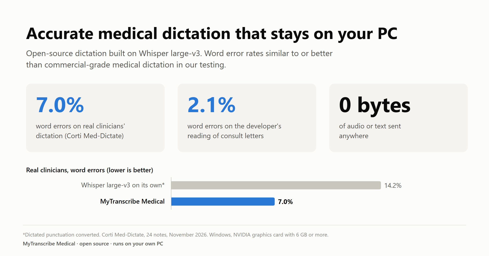
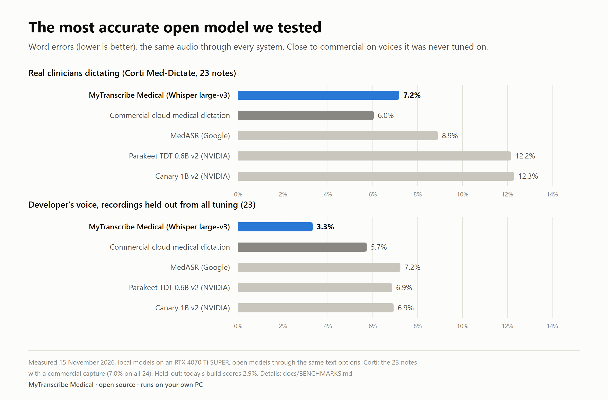

# MyTranscribe Medical

**Accurate English medical dictation that runs entirely on your own Windows PC, with an
ordinary headset.** Dictate a letter or a note, stop, and paste the text into your EMR or
Word. Nothing you say leaves the computer.

> **Status: early testing.** It is used daily by one physician and is now being opened to
> a small group of clinician testers. It is a dictation tool, not a medical device: like any
> dictation, **you read and correct the text before it goes into a record.**

- **Built for clinical dictation:** consult letters, referral notes, results messages. It
  knows about 2,400 drug names and 1,100 primary-care terms, writes readings the way a chart
  does (138/78, 124 g/L, 37.2 °C), and understands spoken formatting and punctuation ("new
  paragraph", "comma", "period").
- **Private by design:** speech recognition runs on your PC with no internet connection. Audio
  is kept in memory only, never written to disk; the log never contains what you dictated; and
  each copy is kept out of Windows clipboard history and cloud sync.
- **No special microphone:** the results below were dictated through an ordinary headset, and
  the speech model was also tested on telephone-quality and noisy-ward recordings.
- **One installer for any Windows PC.** With an NVIDIA graphics card it runs OpenAI's Whisper
  large-v3; on any other PC, including laptops with Intel or AMD graphics, the smaller Whisper
  small.en on the processor. See [Two ways it runs](#two-ways-it-runs).
- **Free and open source** (MIT licence). Both speech models are OpenAI's Whisper (MIT).

**[Download the installer](https://github.com/seanmichaelmcgee/MyTranscribe/releases)**
(Windows 11, 1.2 GB) · [What you need](#what-you-need) · [Install](#install)

## How accurate is it?

**In our testing, its word error rates are similar to or better than commercial-grade medical
dictation**, and clearly ahead of the other open speech models we tried. The full scorecard,
with every test set and condition, is in **[docs/BENCHMARKS.md](docs/BENCHMARKS.md)**.

"Word errors" is the share of words wrong, missing or added compared with what was meant to be
said; lower is better.

| Same audio, word errors | **MyTranscribe Medical** | MedASR (Google) | Parakeet 0.6B (NVIDIA) | Canary 1B (NVIDIA) | Commercial medical dictation |
|---|---|---|---|---|---|
| Real clinicians dictating ([Corti Med-Dictate](https://huggingface.co/datasets/corti/med-dictate), 23 notes) | **7.2%** | 8.9% | 12.2% | 12.3% | 6.0% |
| Developer's recordings, held out from tuning (23) | **3.3%** | 7.2% | 6.9% | 6.9% | 5.7% |
| Developer reading invented letters, every mark dictated (26) | **2.1%** | 5.8% | | | 4.8% |

- **Drug names:** 24 of 24 right on the developer's reading (commercial: 23 of 24); 88% across
  462 synthetic recordings in [Modulate's medical dictation set](https://huggingface.co/datasets/modulate/synthetic-medical-dictation).
- **Many voices and conditions** (Modulate, 28 voices, 5.6 hours): 86% of clinical terms
  right overall, 92% over telephone-quality audio, 81% in a simulated busy ward.
- **On voices it was not tuned to** (Corti), it is about one point behind the commercial
  system; on the developer's own voice it makes fewer than half the errors.
- **Against Whisper on its own**, with the dictated punctuation converted, it makes half the
  word errors (14.2% → 7.0% on real clinicians, 5.9% → 2.9% on the developer's voice; step
  by step in [docs/BENCHMARKS.md](docs/BENCHMARKS.md#what-the-pipeline-adds-to-the-open-model)).

### Why we think it is fit for clinical dictation, and what is not yet shown

- **It is accurate where it matters most.** Its word error rates are in the range of
  commercial-grade medical dictation, and on the developer's recordings it got every drug name
  and dose right.
- **It is built not to make things up.** A misheard drug name is only ever changed to a real,
  approved drug, and only when the misheard word sounds like it and sits where a drug belongs
  (before a dose, in a medication list). It can still pick a similar-sounding real drug, usually
  one of the same class, so **drug names must be checked**, as with any dictation. Words the
  app cannot place are highlighted for you to check. Known Whisper "phantom" phrases (such as
  "Thank you for watching") are removed.
- **Nothing leaves the PC.** See [Privacy](#privacy).
- **Not yet shown:** accuracy on many real clinicians' voices and accents, in real clinic
  noise, and in day-to-day use by anyone but the developer. Names of people are its weakest
  point (as for every system tested). Gathering that evidence is what the testing phase is for.

## Two ways it runs

The app checks the PC each time it starts and picks the model itself.

| | **NVIDIA graphics card** | **Processor only** |
|---|---|---|
| Which PCs | NVIDIA card with 6 GB or more | Every other PC, including laptops with Intel or AMD graphics (not used yet) |
| Speech model | Whisper large-v3 (3 GB, downloaded once, after asking) | Whisper small.en (in the installer) |
| Word errors, live app¹ | **3.0%** | **6.0%** |
| Text ready after you stop, median, live app¹ | **0.8 s** | **1.9 s** |
| Medical words wrong² (of 314) | **12** | **36** |

1. The developer's 23 held-out recordings played in real time into the running app (graphics
   card: RTX 4070 Ti SUPER; processor: 4 efficiency cores of a desktop Core i9, standing in for a
   laptop). An older laptop will be slower; that has not been measured yet.
2. 47 recordings of the developer's voice, the same pipeline, model study of 2026-11-19.

**On the processor it makes about three times as many medical-word errors**, mostly in drug
names, so read the text with that in mind. Every accuracy figure above this section is for
large-v3 on a graphics card.

## What you need

| | NVIDIA graphics card | Processor only |
|---|---|---|
| Windows | Windows 11, 64-bit, with current updates | same |
| Processor | any 64-bit | measured on 4 cores; fewer has not been tried |
| Graphics | NVIDIA, 6 GB or more for large-v3; a driver recent enough for CUDA 12 | not needed |
| Memory (RAM) | 8 GB: loading large-v3 briefly takes 3.5 GB | the app itself peaks under 1 GB |
| Disk | 1.6 GB, plus 3 GB for large-v3 in your user folder | 1.6 GB |
| Internet | once, for the large-v3 download | not needed |

- **Graphics-card memory:** large-v3 used about 2.2 GB on an RTX 4070 Ti SUPER and up to 3.9 GB
  on a 6 GB GTX card (a different number format; same accuracy). With 3.5 to 5 GB the app
  chooses the faster large-v3-turbo (1.6 GB download), and below that small.en on the card.
- **A headset or microphone.** An ordinary USB or Bluetooth headset is fine.

## Install

1. **Download** `MyTranscribe-Medical-Setup-<version>.exe` from
   [Releases](https://github.com/seanmichaelmcgee/MyTranscribe/releases). Its SHA256 is
   in the release notes.
2. **Run it.** It is not code-signed yet, so Windows says "Windows protected your PC": choose
   **More info → Run anyway**. It installs for your Windows account only (no administrator
   rights), adds desktop and Start-menu shortcuts, and is removed in Settings → Apps. It shows
   the licence terms ([LICENSES.md](LICENSES.md)) for you to accept first. On a work PC that only
   allows approved programs, IT has to allow it.
3. **Start MyTranscribe.** The first start opens the setup wizard (below). On a PC with an
   NVIDIA card it then asks before downloading large-v3 (3 GB, once, from Hugging Face). Until
   it is downloaded, or if you say no, the app uses small.en, and it offers the download again
   at the next start.

The first start opens a short **setup wizard** (about three minutes). It first asks how you
dictate: traditionally, saying the punctuation, or in natural speech. Then it covers which
microphone, with a level check that sets the gain; where the text should go; and which key or
mouse button starts and stops dictation. After the first question, **Use recommended for the
rest** skips the others, and **Options (⚙) → Run setup again** reopens it at any time.

Then the model loads for a few seconds ("Loading speech model…"); the button unlocks when it
is ready.

**From the source code** (developers, or to change the app): install Python 3.11, download this
project, run `scripts\setup_1060.bat` (a private Python environment and the models, set up for
an NVIDIA card) and start `MyTranscribe.bat`. Details: [README_1060.md](README_1060.md#install-windows).
How the installer is built: [installer/README.md](installer/README.md).

## Dictating

1. Click into your EMR or document where the text should go.
2. **Hold F9** and talk, then release. (Or press the **mouse forward/thumb button** once to start
   and again to stop, or click **Start dictation**, or press **Ctrl+Alt+Q** anywhere.)
3. Start talking when the light turns **green**. It is **red** when not recording.
4. When the status says **Copied**, paste with **Ctrl+V**.

The window stays on top and small (compact view); **+** shows the transcript, **–** hides it.
The keys never pull the window to the front, so your cursor stays in your EMR. One recording
can last up to an hour; long dictation is transcribed in the background while you talk, so
the text is usually ready within one to three seconds of stopping.

**Say formatting and punctuation out loud:** "new paragraph", "new line", "open quote … close
quote", and (with Spoken punctuation on) "period", "comma", "colon", "question mark", "open
parenthesis". "Her last period" and "the sigmoid colon" stay words. Numbered lists work: "new
line, 1 period, dry eyes" gives a new line starting "1. Dry eyes".

**Always read the text before signing**, especially drug names, doses, numbers and left/right.

## Setting the microphone level

**Options (⚙) → Microphone → Check my microphone…** does this for you: stay quiet for three
seconds, read one sentence, and it sets the gain and says if the room is noisy or the voice too
quiet. Otherwise, the thin bar above the Start button shows how much sound the app is getting:

- **green and moving while you speak:** right;
- **mostly amber while you speak:** too quiet. Raise **Options (⚙) → Microphone → Gain**;
- **red:** too loud. Lower the gain, or move the microphone away from your mouth.

Gain 50 leaves the sound as the microphone sends it; each step either way is 0.4 dB, so 100 is
about ten times louder and 0 ten times quieter. A very quiet microphone is best raised first in
Windows (Settings → System → Sound → Input → Volume), then fine-tuned here. Raising the gain
also raises background noise: aim for the lowest setting that keeps the bar green while you talk.

## Options

Open with the **⚙** button. Everything is saved for the next start.

| Option | What it does | Default |
|---|---|---|
| Run setup again | The setup wizard from the first start, with your current choices filled in. The settings it replaces are kept in `settings.before-setup.json` beside the settings file. | |
| Microphone | Which microphone to record from. A chosen microphone that is unplugged falls back to the Windows default. | Windows default |
| Keyboard key / Mouse button, hold or toggle | Which key and mouse button start and stop dictation, and whether you hold them while talking or press once to start and once to stop. Ctrl+Alt+Q and Space (window focused) always work. | F9 hold, mouse toggle |
| Microphone gain | Makes the microphone louder or quieter (see above). | 50; adjust once for your microphone |
| Keep microphone ready | Keeps the microphone open between dictations so your first word is not clipped. Windows shows the microphone as in use while the app is open. | On |
| Start / stop sounds | Volume of the start and stop chimes; 0 mutes them. | 100% |
| Recogniser | The speech model. Whisper is the default and recommended, and the only one in the installer. From the source code, MedASR (Google) is a faster alternative that each user must request from Google. | Whisper |
| Accuracy | With an NVIDIA card: Best = large-v3; Fast = large-v3-turbo, quicker and a little less accurate (for slower cards). On the processor it shows the model instead (small.en). | Best |
| Dictation language | English. Spanish and French are experimental (see below). | English |
| Pause-aware dictation | Keeps a sentence together when you pause to think, puts back a spoken "new paragraph" the model skipped, and listens a moment after you stop so the last word is not cut off. | **On** |
| Spoken formatting | "New line", "new paragraph", "open quote … close quote". | On |
| Spoken punctuation | For people who say the marks ("period", "comma"…). Leave off if you let the app punctuate. | Off; turn on if you dictate the marks |
| Only the commas I dictate | With spoken punctuation: removes the commas the model adds by itself. For people who dictate every comma. | Off; turn on if you dictate every comma |
| Medical clean-up | Writes readings the chart way (138/78, g/L, °C, mg/day), puts a misheard drug name right when it sits where a drug belongs, capitalises brand names, writes "I would" where "I'd" was written for it. | **On** |
| Paste automatically after stopping | When you stop with the key or mouse button, the text is pasted for you. The on-screen button only copies. Some remote (Citrix) EMRs block this; then paste with Ctrl+V. | Off |
| Type into my document while I dictate | Pastes finished sentences at the cursor about every 6 seconds while you keep talking, with the same paragraphs and punctuation as the copied text. Slightly less accurate than copying at Stop (2.9% vs 2.4% word errors on the developer's recordings). | Off |
| Start in compact view | Opens with the button only. | On |

**Show log…** (Options → Troubleshooting) opens the recent log: timings and errors, never what
you dictated.

### Your usual medications

Before each piece of speech the model is shown a short list of the drugs you prescribe most, so
it hears them right ("bisoprolol", not "mesoprolol"). Put your own list, one drug per line
(about 25; "empagliflozin (Jardiance)" is fine), in `%APPDATA%\MyTranscribe\my_medications.txt`.
It replaces the bundled example list. Colleagues' names and local services can go in a
vocabulary file: see [README_1060.md → Medical vocabulary](README_1060.md#medical-vocabulary).

## Languages

English is the language this version is built and validated for. **Spanish and French** are
offered as experimental: they use the same model, with commands and punctuation in that
language and draft medical term lists that no Spanish- or French-dictating clinician has
checked yet. They were tested on public read-speech sets (2.3% and 5.5% word errors) and
computer voices and, for French only, on seven real dictated notes (8.7%). Swahili is not offered in this version until it has been validated. Details:
[docs/optimization/2026-11-16-multilingual.md](docs/optimization/2026-11-16-multilingual.md).

## Other graphics and computers

Intel and AMD graphics are not used yet: on those PCs the app runs on the processor (see
[Two ways it runs](#two-ways-it-runs)). On the processor the text comes about 2 seconds after a
short message and 4 to 8 seconds after a long letter, on laptop-class cores. Other graphics
cards (through Vulkan) and Apple computers are planned:
[docs/CPU_AND_OTHER_HARDWARE_PLAN.md](docs/CPU_AND_OTHER_HARDWARE_PLAN.md).

## Privacy

- Speech recognition runs on your PC. The app does not connect to the internet, except to
  download a speech model, and then only after asking you.
- Audio is held in memory and discarded; it is never written to disk.
- The log records timings, lengths and errors, never what you dictated.
- Each copy to the clipboard is marked so Windows clipboard history and cloud sync do not keep it.
- **Your side:** use full-disk encryption (BitLocker), a login password with auto-lock, and turn
  off Windows Settings → System → Clipboard → Clipboard history and Sync across devices. Check
  with whoever handles privacy for your practice. This is not legal advice.

## Troubleshooting

| Problem | What to do |
|---|---|
| The text says the app is using small.en although you have an NVIDIA card | large-v3 is not downloaded yet: start the app again and answer **Yes** to the download. |
| The large-v3 download fails (Options → Show log says why) | The app checks huggingface.co's certificate against the certificates Windows trusts, as your browser does. Check that huggingface.co opens in your browser; on a work network, ask IT. Until it is downloaded, the app uses small.en. |
| "Could not load the speech model" | Options → Show log has the details. From the source code, run `scripts\setup_1060.bat` again. |
| Words missing, especially quiet ones | Watch the level bar while you speak and raise Options → Microphone → Gain until it is green. |
| Text very slow to appear, "falling behind" in the log | Options → Accuracy → Fast. |
| Status says "Not copied" | Another program was using the clipboard: click **Copy**, then paste. |
| Auto-paste does nothing in the EMR | Remote/Citrix sessions can block it; paste with Ctrl+V. |
| The log says `device=cpu` although you have an NVIDIA card | Update the NVIDIA driver and check that `nvidia-smi` works in a terminal. More in [README_1060.md → Troubleshooting](README_1060.md#troubleshooting). |

## Testers: how to help

Use it for real dictation alongside your usual method and tell us what went wrong: a word or
drug name it got wrong (described in invented words, never a real patient's details), a
command it missed, anything confusing in the window or Options. **Never send real dictation,
audio or patient information.** A structured way to measure accuracy on your own voice with an
invented reading script, without sharing anything real, is in [docs/VALIDATION.md](docs/VALIDATION.md).

## More detail

- [README_1060.md](README_1060.md): full reference: every option, environment variables,
  vocabulary files, recognisers and their licences, older and 6 GB graphics cards.
- [docs/](docs/README.md): an index of all the documentation.
- [docs/settings/](docs/settings/README.md): how defaults and the setup wizard's choices are
  decided.
- [docs/testing/](docs/testing/README.md): what the app is tested with, where audio is kept
  (never on GitHub), and how voice service terms were read.
- [docs/VALIDATION.md](docs/VALIDATION.md): how accuracy is measured on your own voice.
- [docs/optimization/](docs/optimization/): each round of measurements and what was changed.
- [NOTICE.md](NOTICE.md): third-party models, word lists and their licences.
- Developers: `venv1060\Scripts\python.exe -m pytest -q tests` runs the tests (no microphone,
  graphics card or model needed). The app is `src/gui_med.py`.
- The original general-purpose MyTranscribe app is described in
  [docs/ORIGINAL_APP.md](docs/ORIGINAL_APP.md).

## Licence

MyTranscribe Medical is open source under the MIT License ([LICENSE.txt](LICENSE.txt)). The
installer also carries the software the app runs on, each part under its own licence (Qt under
the LGPL, NVIDIA's cuBLAS under NVIDIA's licence, and others): see [LICENSES.md](LICENSES.md).
