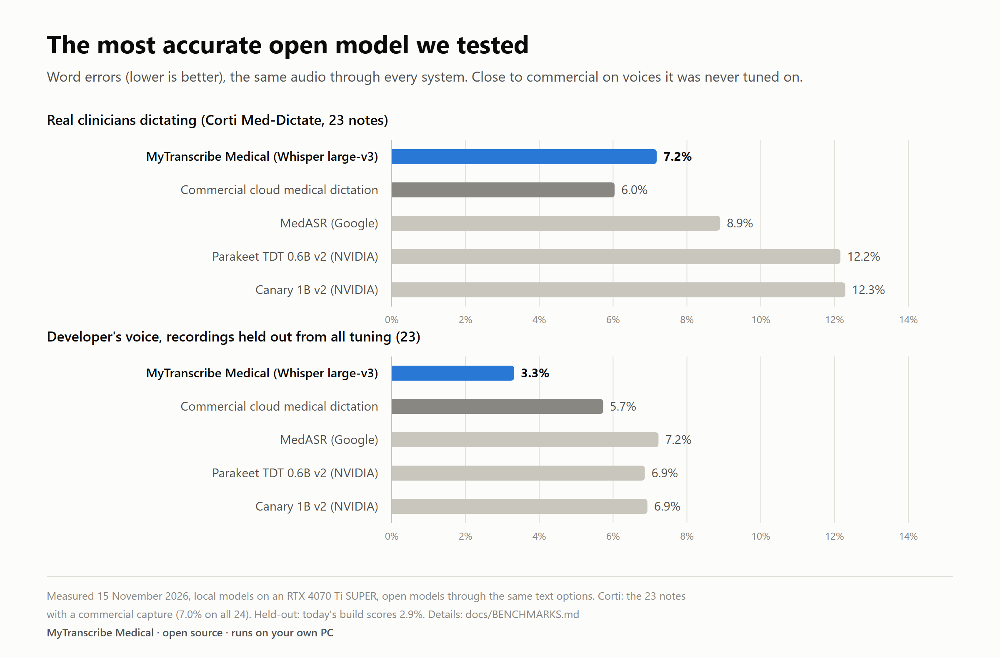
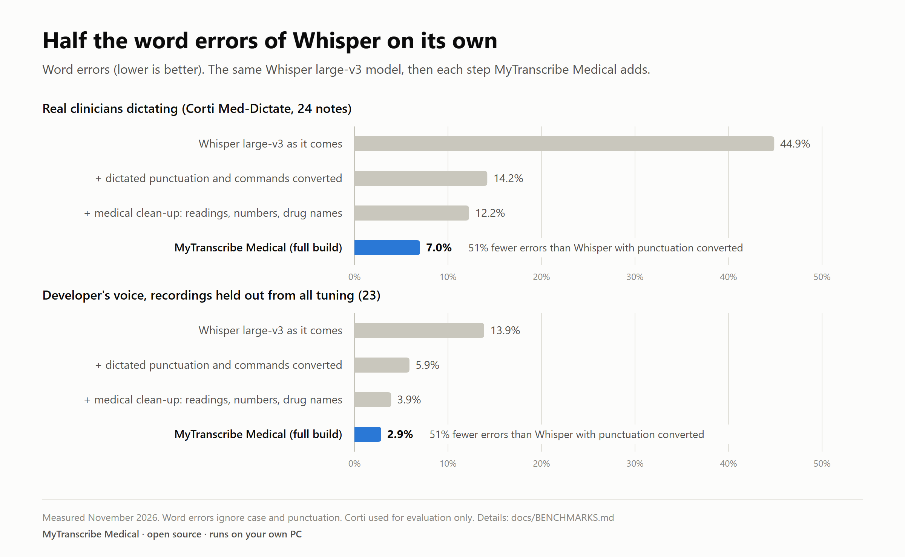
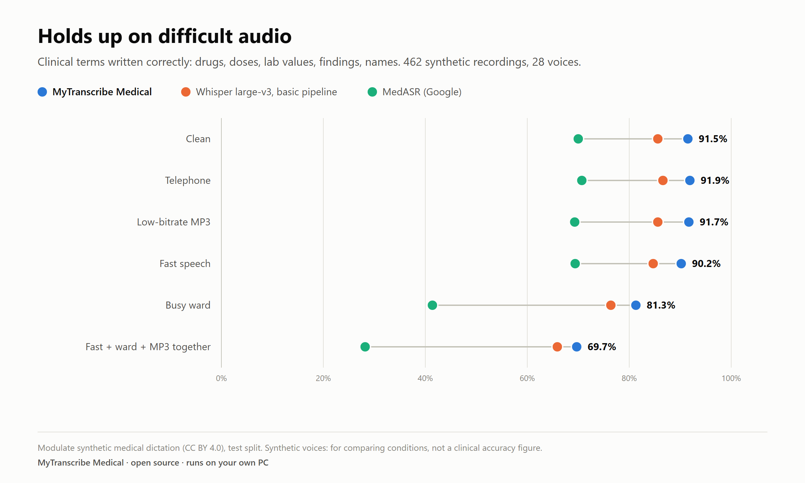

# MyTranscribe Medical: benchmark scorecard

**Open-source, offline medical dictation with word error rates similar to or better than
commercial-grade medical dictation in our testing**, and ahead of every other open speech
model we tried, on real clinicians, on the developer's own voice, and on hundreds of synthetic
recordings in difficult conditions.

All figures: Whisper large-v3 running on the user's own PC (no cloud), through the
MyTranscribe Medical pipeline with its default options (pause-aware dictation, medical
clean-up) and, where the speakers dictate the marks, spoken punctuation. Measured
November 2026. Lower word error rate (WER) is better; higher recall is better.

## At a glance

| | |
|---|---|
| **2.1%** | word errors, developer reading invented consult letters with every mark dictated |
| **7.2%** | word errors on real clinicians' dictation it was never tuned on (Corti Med-Dictate) |
| **24 / 24** | drug names right on the developer's reading; **15 / 15** doses |
| **86%** | clinical terms right across 462 synthetic recordings, 28 voices, six recording conditions |
| **92%** | clinical terms right over telephone-quality audio |
| **0.8 s** | median wait from Stop to finished text in the live app (graphics card) |
| **0** | bytes of audio or text sent anywhere |

Images of these results for sharing are in [images/](images/) (redraw them with
`python scripts/make_promo_images.py` after changing a figure here).

## Head to head: the same audio through every system

Word error rate. Each system got the same recordings; the best result in each row is in bold.

| Test set | **MyTranscribe Medical** (Whisper large-v3 + pipeline) | MedASR (Google) | Parakeet TDT 0.6B v2 (NVIDIA) | Canary 1B v2 (NVIDIA) | Commercial medical dictation |
|---|---|---|---|---|---|
| **Real clinicians**: [Corti Med-Dictate](https://huggingface.co/datasets/corti/med-dictate), English, 23 notes, every mark dictated | 7.18% | 8.90% | 12.16% | 12.29% | **6.04%** |
| **Developer's voice, held out** from all tuning (23 recordings) | **3.32%** | 7.23% | 6.86% | 6.93% | 5.73% |
| **Developer reading invented letters** and messages, every mark dictated (26 items) | **2.08%** | 5.83% | not run | not run | 4.83% |
| Developer's voice, development set used for tuning (24 recordings) | **10.48%** | 13.33% | 12.91% | 13.12% | not run |
| Compute for 66 minutes of audio (RTX 4070 Ti SUPER) | 209 s | 20 s | 32 s | 99 s | cloud |

- **MyTranscribe is the most accurate open system on every set**, and beats the commercial
  system on the developer's voice by a wide margin (2.1% vs 4.8%, 3.3% vs 5.7%).
- **On other clinicians' voices it is within about one point of the commercial system**
  (7.2% vs 6.0%), with no tuning to those speakers. On all 24 Corti notes: 7.01%.
- **MedASR** is ten times faster and good on drug names, but loses people's names, dates of birth
  and the first words of a note. **Parakeet** and **Canary** have no medical vocabulary and miss
  drug and clinical terms.
- The developer's development set is harder (two scripts were read inconsistently), which is
  why every system scores higher on it; compare across a row, not down a column.

## What the pipeline adds to the open model

The same Whisper large-v3 model files, first exactly as they come (faster-whisper's own
defaults: no prompt, its own 30 s windows, previous text carried forward), then with the app's
steps added one at a time:

| Step | Real clinicians (Corti, 24 notes) | Developer's voice, held out (23) |
|---|---|---|
| Whisper large-v3 as it comes | 44.89% | 13.87% |
| + spoken punctuation and commands turned into marks and layout | 14.20% | 5.88% |
| + medical clean-up (readings, units, spoken numbers, drug names) | 12.25% | 3.92% |
| + the app's recognition: medical prompt, pause-aware windows, term correction (**the full build**) | **7.01%** | **2.86%** |

- **Half the errors of Whisper used sensibly.** Against off-the-shelf Whisper with only the
  dictated marks converted, which any dictation tool would need, the full build makes about
  half the word errors on both sets (14.2% → 7.0%, 5.9% → 2.9%).
- The first row is mostly the dictated words "period", "comma", "new paragraph" left in the text.
  It also includes a known Whisper failure: on one Corti note it repeated a sentence 13 times
  (121 extra words). The app's own windows and settings prevent that.
- Layout (paragraphs, lists) on the held-out recordings: 0 / 12 as it comes, 12 / 12 with the
  commands step.
- Compute for Corti's 66 minutes: 334 s as it comes, 209 s for the full build (RTX 4070 Ti SUPER).
- Measured 2026-11-17 with `scripts/untouched_whisper.py`; the text steps were applied to the
  same raw text, and the full build's Corti text is the saved November 15 run, scored again
  beside it with the same frozen scorer. This was one further Corti run, evaluation only.

## Drug names, doses and clinical terms

| | MyTranscribe Medical | MedASR | Commercial |
|---|---|---|---|
| Drug names right, developer's reading (24) | **24** | **24** | 23 |
| Doses right, developer's reading (15) | **15** | 14 | 14 |
| Drug names found, Modulate synthetic test split (924 mentions) | **88%** (73% before drug-name correction) | 67% | not run |

Drug-name correction only ever writes a real, approved drug name (2,364 from the FDA Orange
Book and RxNorm), and only where a drug belongs (before a dose, in a medication list). Of 204
changes on the Modulate test split, 193 were right; the 11 wrong ones turned a garbled word
into a different real drug, so drug names must still be checked, as with any dictation.

## Many voices, difficult audio

[Modulate synthetic medical dictation](https://huggingface.co/datasets/modulate/synthetic-medical-dictation)
(CC BY 4.0): 77 test notes read by 28 computer voices in six recording conditions, 462
recordings, 5.6 hours. Score: share of 9,366 clinical terms (drugs, doses, lab values,
findings, names, dates of birth, chart numbers) written correctly.

| Condition | **MyTranscribe Medical** | Plain Whisper pipeline | MedASR |
|---|---|---|---|
| All recordings | **86.1%** | 80.8% | 58.2% |
| Clean | **91.5%** | 85.6% | 70.0% |
| Telephone | **91.9%** | 86.6% | 70.7% |
| Low-bitrate MP3 | **91.7%** | 85.6% | 69.3% |
| Fast speech | **90.2%** | 84.7% | 69.4% |
| Busy ward | **81.3%** | 76.4% | 41.4% |
| Fast + ward + MP3 together | **69.7%** | 65.9% | 28.2% |
| Dates of birth | **83.1%** | 0.0% | 0.9% |
| Chart numbers | **91.3%** | 83.3% | 5.6% |
| Doses / lab values | **98.8% / 98.2%** | 98.5% / 96.9% | 87.3% / 87.2% |

## Dictation that works like dictation

| Developer's held-out recordings (23) | Plain pipeline | **MyTranscribe Medical** |
|---|---|---|
| Spoken commands found (new paragraph, new line, quotes, numbered items) | 54 / 56 | **56 / 56** |
| Layout right (paragraphs, lists) | 11 / 12 | **12 / 12** |
| Last word kept when Stop comes 0.15 s early | 2 / 23 | **18 / 23** |
| Sentence breaks wrongly put at a 1.5 s thinking pause | 6 | **2** |

**Live app**, recordings played in real time into the running window: 3.01% word errors,
56 / 56 commands, 12 / 12 layouts, text **0.8 s** after Stop (median; 1.8 s at most).

## Typing as you dictate

Text pasted at the cursor while you keep talking, against the text copied at Stop, on the
developer's 54 recordings with a script (2,855 words):

| | Copied at Stop | Typed as you dictate |
|---|---|---|
| Word errors | 2.35% | 2.91% |
| Layout right (paragraphs, lists) | 24 / 24 | 24 / 24 |
| New text appears | at Stop | about every 6 s |
| Typed text identical to the copied text | | 54 of 54 recordings |

Details: [optimization/2026-11-17-live-insert.md](optimization/2026-11-17-live-insert.md).

## Hardware

| | |
|---|---|
| Graphics card | NVIDIA, 6 GB or more. Uses about 3.7 GB. Same accuracy in the 6 GB-card number format (2.08% on the developer's reading). |
| Processor only | Being tested: large-v3 runs at half real time on a fast desktop processor (6–7 s wait after a short message); a smaller model is being chosen. See [CPU_AND_OTHER_HARDWARE_PLAN.md](CPU_AND_OTHER_HARDWARE_PLAN.md). |
| Model | OpenAI Whisper large-v3 (MIT), about 3 GB, downloaded once, then fully offline. |

## Experimental languages

Same model, with commands, punctuation and draft medical terms in each language. Not yet
reviewed by clinicians who dictate in them.

| | Word errors |
|---|---|
| Spanish, public read speech ([FLEURS](https://huggingface.co/datasets/google/fleurs), 300 sentences) | 2.29% |
| French, public read speech (FLEURS, 300 sentences) | 5.52% |
| **French, real clinicians dictating** (Corti, 7 notes) | **8.68%** (32.96% without the French pack) |

## How these were measured, and how far to trust them

- **Word error rate** counts substituted, missing and extra words against what was meant to be
  said, after lower-casing and removing punctuation. It is mechanical: "5 mg" against "five
  milligrams" counts as an error, so small differences between systems are noise. Look for a gap
  of a point or more.
- **Corti Med-Dictate** was used for evaluation only, as its licence requires, and run a small,
  fixed number of times; nothing was tuned on it. The commercial system's Corti figure is from
  October 2026 captures of 23 of the 24 notes.
- **The developer's recordings** are invented texts read through an ordinary headset. They show
  what the app does for a voice it has been tuned with; Corti and Modulate show other voices.
- **Modulate** voices are synthetic: good for comparing systems and conditions, not a measure of
  accuracy on real clinicians. Its test split was consulted while setting the drug-name
  thresholds, so the drug-name figure is not fully held out.
- **The commercial reference** is a widely used cloud medical dictation product with a medical
  vocabulary, run on the same audio (played through a virtual audio cable for the developer's
  recordings).
- **Not yet measured:** many real clinicians' voices and accents, real clinic noise, and
  everyday use by anyone but the developer. That is what the tester phase is for.

Method details, every condition and the raw tables:
[VALIDATION.md](VALIDATION.md),
[optimization/2026-11-15-dictation-reliability.md](optimization/2026-11-15-dictation-reliability.md),
[optimization/2026-11-16-multilingual.md](optimization/2026-11-16-multilingual.md).
